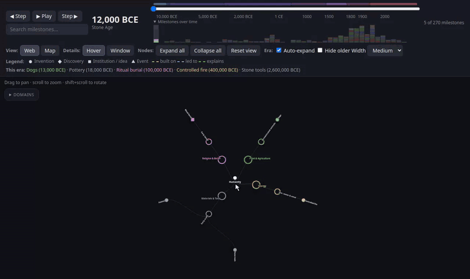

# Interactive History of Human Progress

An interactive, offline map of human progress: 270 milestones across 15 domains (food, health, shelter, energy, science, government, empires and more), from 12,000 BCE to today. Shown as a radial web or a world map, driven by a timeline slider.

## Running

Open `index.html` in a browser. No server, build step or internet connection needed (except for the Wikipedia links).

## Files

- `index.html` — the viewer (layout, styles and all logic)
- `data.js` — `REGIONS` and `NODES`, the content
- `world.js` — `LAND`, Natural Earth 1:110m land outlines as one SVG path
- `demo.gif` — the demo above

## Using it

- **Slider / Play** — move through time. The slider is non-linear so recent centuries get more room. Colored bands mark eras.
- **Step ◀ ▶** — jump to the next batch of milestones (8, or one era-width), and finally to today. The header lists everything new since the last step.
- **Milestones over time** — bar chart under the slider (open by default), stacked by domain. Click a bar to jump there.
- **Web / Map** — radial tree of domains → groups → milestones, or dots placed by region.
- **Hover** a node to show it in the details panel. The panel keeps the last hovered node.
- **Click** a group to open or close it. **Click** a milestone to pin it: unrelated nodes dim and the panel stops following hover. **Esc** unpins.
- **Drag** to pan, **scroll** to zoom, **Shift + scroll** to rotate the web. Map icons and labels keep their size as you zoom.
- **Details panel** — drag its title bar to move it; **–** shrinks it to the title bar.
- **Search**, **Expand all / Collapse all**, **Auto-expand era**, **Hide older**, **Era width**.
- **Domain checkboxes** — keep a domain collapsed and hide it from the map and chart.

Shapes show the kind of milestone: circle = invention, diamond = discovery, square = institution / idea, triangle = event.

Dashed links on the selected node: amber = built on, blue = led to, green = explains (a discovery that finally explained something people had already used for a long time, e.g. combustion explaining fire).

## Data format

Each entry in `NODES`:

| Field | Meaning |
|---|---|
| `id` | Unique id |
| `parent` | Parent group id (`humanity` for domains) |
| `name` | Display name |
| `year` | Year, negative for BCE. Omit for groups (computed from children) |
| `desc` | Description, shown in tooltips and the panel |
| `from` | Ids of earlier milestones this built on |
| `explains` | Ids of earlier milestones this discovery explained |
| `where` | A key in `REGIONS` (optional; without it the milestone is not on the map) |
| `wiki` | Wikipedia article title |
| `kind` | `invention`, `discovery`, `society` or `event`; inherited from the parent if omitted |

`from` and `explains` must point to milestones with an earlier year. New domains also need a color in `COLORS` in `index.html`; its key order sets the order around the web.

## Caveats

- Dates for ancient milestones are approximate.
- The map shows regions, not historical borders.
- Wikipedia links go through search, so a slightly off title still lands on results.

## Credits

Land outlines: [Natural Earth](https://www.naturalearthdata.com/) (public domain).
